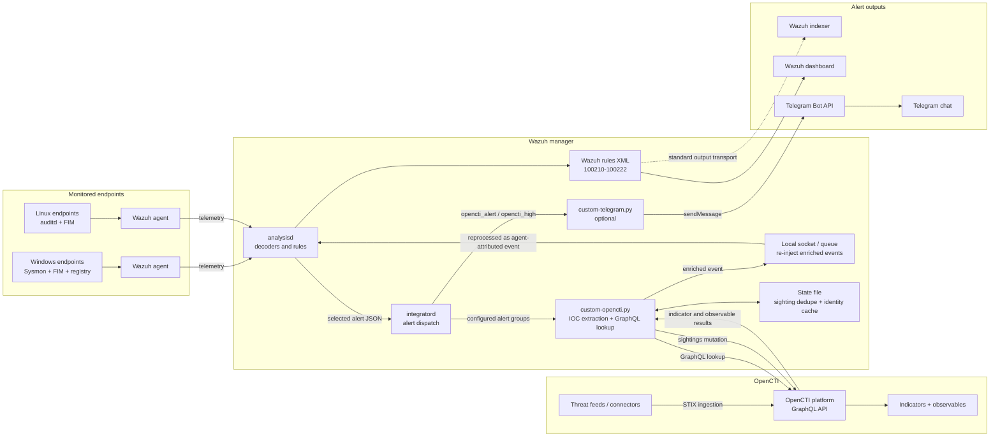

# Wazuh + OpenCTI: Bidirectional Threat Intelligence (Master Project)

**AegisryxLabs · SOC Automation Series**
Author of the lab writeup: Md. Abu Saeid · Extraction engine and rules: Ramkumar's
*Opencti-Intergated-Wazuh-With-Sysmon-And-Audit* repo

This project merges two earlier builds into one deployable package:

| Source | What it contributed |
|---|---|
| **Ram Kumar repo** (`opencti-custom.py`, Sysmon/auditd rules, agent groups) | Robust IOC extraction from real Wazuh alert structures (Sysmon, FIM/registry, auditd, IDS), OpenCTI GraphQL query + event schema, detection rules, endpoint hardening |
| **AegisryxLabs writeup** (Phase 2 "Pure GraphQL") | The bidirectional idea: STIX **sightings** written back to OpenCTI, zero-disk design, Telegram alerting, deployment checklist, the bug list |

## System architecture



This project implements the real flow: endpoint telemetry reaches Wazuh, the custom OpenCTI integration extracts IOCs, queries OpenCTI for indicator matches, re-injects enriched events into Wazuh, and optionally creates STIX sightings and Telegram notifications.

[Open the interactive architecture diagram](assets/system-architecture.html).
[View the full architecture reference in docs/ARCHITECTURE.md](docs/ARCHITECTURE.md).

## How it works

```
 Threat feeds (OTX, AbuseIPDB, MalwareBazaar, VirusTotal, MISP...)
              | OpenCTI connectors
              v
        OpenCTI  (indicators + observables)  <---------------------+
              ^   GraphQL lookup per IOC                            |
              |                                                      | STIX sighting
 Wazuh agent -> Wazuh manager -> rule fires -> custom-opencti.py ----+  (indicator "sighted in" Wazuh SIEM)
 (Sysmon, auditd, FIM)                              |
                                                    | enriched event {"integration":"opencti",...}
                                                    v
                                      Wazuh analysisd -> rules 100210-100222 -> dashboard / Telegram
```

1. An endpoint event raises a Wazuh alert whose rule group is listed in the `<integration>` block.
2. `custom-opencti.py` pulls IOCs from the alert: hashes (including hash-named files and BAM keys),
   public IPs, URLs, domains (file extensions filtered out), filenames, auditd command lines
   (including hex `proctitle` decoding).
3. Each IOC is looked up in OpenCTI (indicator pattern + observable). Low-score / revoked
   indicators are dropped (`MIN_SCORE`).
4. Matches go back into Wazuh as `opencti` events (agent-attributed) and fire rules 100212-100216 / 100221-100222.
5. For matched indicators the script writes a **sighting** to OpenCTI, deduplicated per
   indicator + agent per hour, so a noisy host cannot flood OpenCTI.

## Repository layout

```
integration/      custom-opencti(.py|.conf.example.json), custom-telegram(.py|.conf.example.json)
wazuh/rules/      0100 opencti, 0200 auditd, 0300 sysmon groups, 0400 windows ignore, 0410 linux ignore
wazuh/agent-groups/   windows-agent.conf, linux-agent.conf   (shared agent.conf per group)
wazuh/ossec/      <integration> blocks to paste into ossec.conf
endpoints/linux/  auditd rules + setup      endpoints/windows/  Sysmon setup
opencti/          INSTALL.md, env.example   (secrets removed)
optional/         rules that need extra parent rules before they can be enabled
tests/            offline test-suite (mock OpenCTI) + sample alerts
docs/             DEPLOYMENT, TESTING, TROUBLESHOOTING, CHANGES-FROM-SOURCES
```

## Quick start

Full steps with checklist: [docs/DEPLOYMENT.md](docs/DEPLOYMENT.md).

1. Deploy OpenCTI ([opencti/INSTALL.md](opencti/INSTALL.md)), connect at least one feed, create an API token.
2. Wazuh manager: create agent groups, install `wazuh/agent-groups/*` as shared `agent.conf`.
3. Copy `wazuh/rules/*.xml` to `/var/ossec/etc/rules/` (`root:wazuh`, `660`).
4. Endpoints: Sysmon on Windows, auditd on Linux ([endpoints/](endpoints/)).
5. Copy `integration/custom-opencti*` to `/var/ossec/integrations/`, `chown root:wazuh`, `chmod 750`.
6. Add `wazuh/ossec/integration-opencti.xml` to `ossec.conf` with your token and URL; `systemctl restart wazuh-manager`.
7. Run the offline tests, then the live test in [docs/TESTING.md](docs/TESTING.md).

## Rule ID map

| Range | File | Purpose |
|---|---|---|
| 100210-100216 | 0100 | OpenCTI events: base, error, indicator match, observable match, related, partial |
| 100221-100222 | 0100 | Escalation to level 14 for score 70+ |
| 100499-100510 | 0200 | auditd targeted binaries (curl, wget, ping, nc, ssh, shells...) |
| 100600-100612 | 0400 | Windows FIM noise suppression |
| **100630-100643** | 0410 | Linux FIM/audit noise suppression (**renumbered**, see below) |
| 101100-101115 | 0300 | Sysmon event groups |
| 100620-100621 | optional/ | Windows process-creation ignore (needs parent rule 100691) |

## Configuration

Defaults live at the top of `custom-opencti.py`. To change them per deployment without editing the script,
create `/var/ossec/integrations/custom-opencti.conf.json` (see the `.example.json`).

| Key | Default | Meaning |
|---|---|---|
| `MIN_SCORE` | 30 | Ignore indicators scored below this |
| `CREATE_SIGHTINGS` | true | Write sightings back to OpenCTI |
| `SIGHTING_DEDUPE_SECONDS` | 3600 | One sighting per indicator + agent per window |
| `WAZUH_IDENTITY_ID` | "" | UUID of the "Wazuh SIEM" System identity (skips a lookup per sighting). Empty = find/create by name |
| `VERIFY_TLS` | true | Set false only for a self-signed HTTPS OpenCTI in a lab |
| `EXTRACT_GENERIC_IPS` | true | Also look up public `srcip/dstip` (sshd, firewall alerts) |
| `EMIT_OBSERVABLE_WITHOUT_INDICATOR` | false | Emit events for observables with no indicator (weak signal) |
| `MAX_IOCS_PER_ALERT` | 12 | Lookup cap per alert; hashes, URLs and IPs are prioritised over domains and filenames |

## Security notes (read before publishing this repo)

- **Rotate every token that appeared in the source material.** The uploaded files contained two
  OpenCTI API tokens (one hard-coded in the Notion script, one in `ossec-conf.md`), plus the
  `OPENCTI_ADMIN_TOKEN` and healthcheck key in the `.env` sample. If the source repo was ever public or shared,
  treat them as compromised. This package ships with placeholders only.
- The token now lives only in `ossec.conf` (`<api_key>`, readable by root/wazuh) or `.opencti_token` (640).
  It is never hard-coded and never written to logs.
- Use a dedicated OpenCTI user for the integration, with only the capabilities it needs (read knowledge, create sightings).
- `VERIFY_TLS` defaults to **true**. The old script disabled certificate checks unconditionally.
- Plain HTTP to OpenCTI sends the token in clear text. Acceptable on an isolated lab segment, not beyond it.

## What changed versus the sources

Short version here; details in [docs/CHANGES-FROM-SOURCES.md](docs/CHANGES-FROM-SOURCES.md).

- One script instead of two: Ram Kumar's extraction + lookup, AegisryxLabs' sightings, dedupe, no `requests` dependency.
- Rule-ID collisions fixed (the Linux ignore file reused 100611, 100612 and 100621 from the Windows one).
- Rules 100620-100621 moved to `optional/`: they depend on rule 100691, which was not in either repo, and a missing `if_sid` parent stops the manager from loading rules.
- Secrets removed from all docs.

## Known limitations / roadmap

- Sightings are created only for indicators (not for plain observables), and never for filename matches.
- Related-indicator matches (for example an IP resolved from a bad domain) raise an alert but no sighting.
- The OpenCTI-facing GraphQL calls were verified against a mock server, not a live OpenCTI. Run the live test once per OpenCTI version.
- Possible next steps: a CDB/stream feed from OpenCTI for offline matching, per-agent identities, active response on score 90+.
