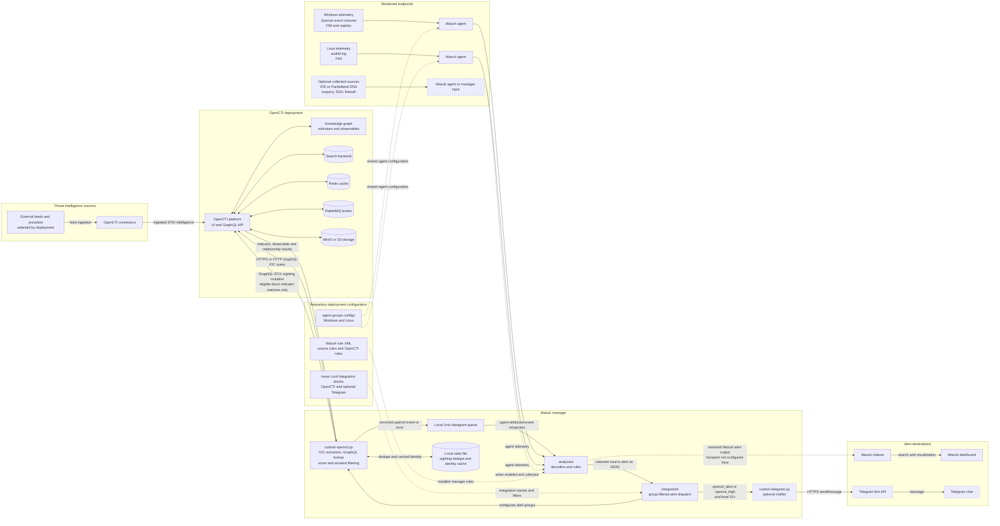

# System Architecture

This diagram shows the configured Wazuh-to-OpenCTI enrichment and sighting loop, plus optional Telegram notification. Dashed connections are deployment configuration or standard Wazuh outputs not implemented by this repository.

## Flow Notes

- OpenCTI connectors ingest deployment-selected threat feeds into the OpenCTI platform. The repository does not provision specific feed connectors.
- Windows and Linux Wazuh agents forward telemetry to the manager. The integration also supports IDS/Packetbeat DNS, osquery, and generic network alert fields when those sources are collected and their rule groups are routed to it.
- The OpenCTI integration queries indicators and observables live through GraphQL; it does not synchronize a local IOC database. Enriched events are written to the manager's local queue and reprocessed by `analysisd` with the originating agent attribution.
- The integration can write a STIX sighting for eligible direct indicator matches. Sightings are deduplicated per indicator and agent for the configured window (one hour by default). Filename and related-indicator matches do not create sightings.
- The optional Telegram integration receives qualifying OpenCTI alerts (groups `opencti_alert` or `opencti_high`, level 10 or above) and sends them through the Telegram Bot API.
- Wazuh indexer and dashboard are shown as the normal Wazuh alert destination. This repository does not configure the manager-to-indexer transport; its custom configuration is the OpenCTI and optional Telegram integrations.